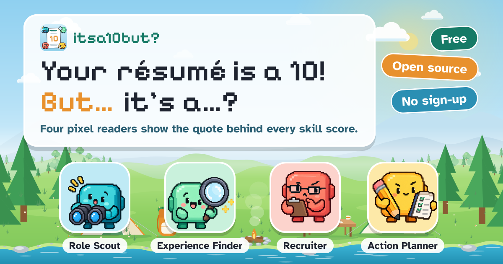
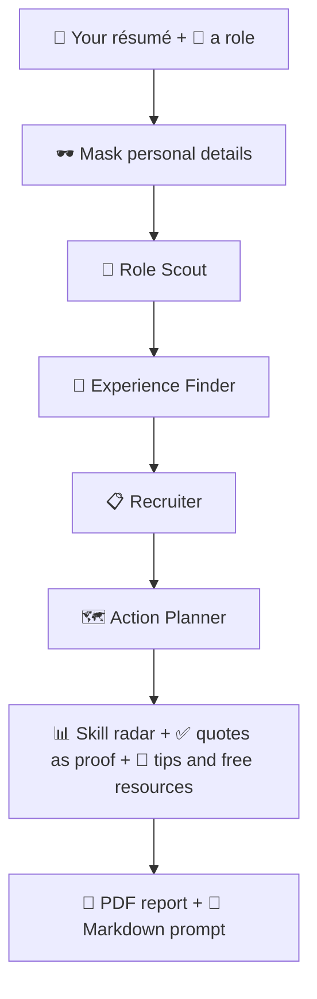
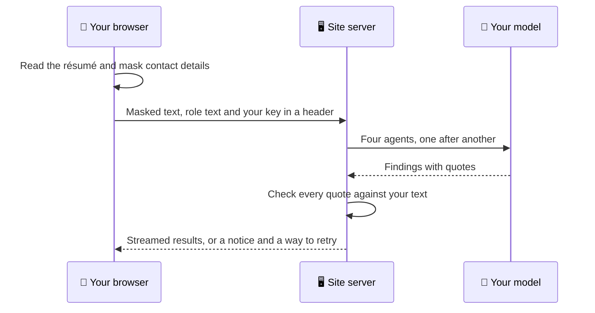
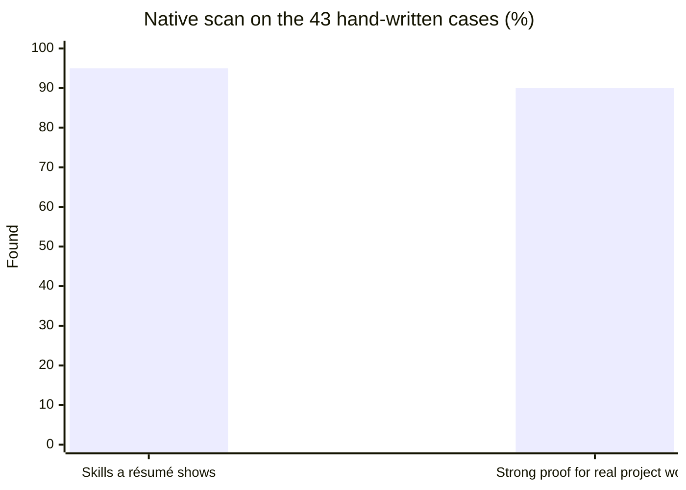

<p align="center"></p>

# 🔟 itsa10but

**Your résumé is a 10! But… is it a 10 for this role?**

[](https://ghernie.com/itsa10but)


itsa10but is a one-page career workspace for students and people moving into tech. You pick a role and add your résumé, or a sample. Four small pixel readers compare the two and show you the gaps. Every score comes with the exact quote behind it, and you can download the result as a PDF report or as a Markdown prompt for your own AI.

🌐 Live site: https://ghernie.com/itsa10but

The idea and the design system were conceived by Ghernie Encinas, who has a strong interest in UI design and creativity. The project is finished and open to improvements.

## 🎯 Problem

Students and people changing careers get résumé feedback that is hard to act on. A score or a checklist rarely says which line of the résumé earned it, which skill the job posting actually asks for, or what to do next. Automated screening (ATS) is a black box, and most résumé tools run on one fixed AI model that you can't inspect, change or pay for yourself.

## 💡 Solution

itsa10but compares one résumé with one real job posting and shows its working. It lists the skills the role asks for, finds the line in your résumé that proves each one, and scores that proof. A skill with no matching line scores 0. The page then turns the biggest gaps into practical tips and free resources, and lets you take the result away as a report.

You can run it with no key at all, or bring your own key for an AI model of your choice.

## ✨ Key features

- 🕸️ Skill radar with a literal quote behind every score, and a Have or Gap mark per skill
- 🔎 Four readers in order: Role Scout, Experience Finder, Recruiter and Action Planner
- 📋 An ATS-style check with a quick review: what to fix first with the real line and a rewrite, what works, and what a recruiter might ask
- 🧰 Tips and free, open-source resources for each gap, with a tabbed Level up library
- 🏢 About company: the employer's published values and how to show you fit, for 14 employers
- 🇸🇬 Singapore market figures, AI headlines and tech news, each dated and linked to its source
- 📄 PDF report and Markdown prompt, built in your browser, with a preview of each
- 🔑 Native scan with no key, or API boost with your own Anthropic, OpenRouter or Gemini key
- 🧪 Sample résumés for eight role paths, labelled as samples
- 🔌 An MCP endpoint so other AI tools can call the job search and the analysis

## 🧭 How it works



| Reader | What it does |
|--------|--------------|
| 🔎 Role Scout | Lists the skills the role asks for |
| 🧐 Experience Finder | Looks for proof of each skill in your résumé |
| 📋 Recruiter | Checks ATS readiness, then gives the quick review |
| 🗺️ Action Planner | Turns the biggest gaps into practical tips and links to free lessons |

Scores describe proof on the page, never your chance of getting hired.

## 🤖 AI integration

The AI is a set of four agents with separate jobs, not one prompt wrapped in a page. Each agent has its own instructions, tools, output schema and limits, and the app checks what it returns.

- Retrieval: your résumé is cut into short passages, and each skill ranks its best-matching passages by word matching. The Experience Finder reads those passages instead of the whole file.
- Quote verification: every quote a model returns is checked against your text by the app. A quote that isn't found word for word scores 0.
- Tools: Role Scout and Action Planner can search the web through Firecrawl. The two agents that read your résumé get local tools only.
- Model choice: you pick the model for all four agents or for each one. Without a pick, API boost runs DeepSeek V4.1 Flash on an OpenRouter key, Gemini 3.1 Flash Lite on a Gemini key, and each agent's own Claude model on an Anthropic key.
- Fallback: if an agent refuses, returns a bad answer or runs out of time, the page says why and lets you try again, fix the key or switch to the native scan.
- Native scan: the same four readers run on word matching and rules in your browser. A small Cloudflare Workers AI model also reads the role text, never the résumé, to find skills the word list misses. Each name it returns must appear word for word in the role text.
- MCP: `/api/mcp` serves the job search, the native analysis and the Singapore snapshot to other AI tools.

| | 🧰 Native scan | 🚀 API boost |
|---|---|---|
| Needs a key | No | Yes, from Anthropic, OpenRouter or Gemini |
| Where it runs | In your browser | Four AI agents on the server, on your key |
| Web lookups | None | Role and company pages, learning links |
| Cost | Free | You pay your own provider, usually under a few cents a run |
| Default | ✅ | Opt in with the switch in the header |

How API boost handles a run:



## 🧩 External tools and datasets

| What | Where from |
|------|-----------|
| Hosting | Vercel |
| Edge Worker | Cloudflare Workers with KV, D1 and Workers AI |
| Models | Anthropic, OpenRouter and Gemini, on the visitor's own key |
| Web search | Firecrawl, optional |
| Résumé parsing | pdf.js in the browser |
| Jobs | Himalayas, Jobicy, Arbeitnow, Remotive and public LinkedIn job pages |
| Singapore figures | IMDA, MOM, PwC, Indeed (via The Business Times) and The Straits Times. Each figure links to its source |
| Market demand | Skills named in recent postings on free remote feeds, and the skills Singapore employers tagged on MyCareersFuture |
| AI headlines | Firecrawl search, refreshed nightly |
| Tech news | Public RSS and Atom feeds, no key and no model |
| Employer values | The employers' own pages, each linked from the result |
| Donations | A Stripe Payment Link in the footer |
| Logos | [Devicon](https://github.com/devicons/devicon) (MIT) and the owners' marks. Origins are in `public/assets/logos/SOURCES.md` |
| Fonts | Pixelify Sans and Atkinson Hyperlegible, both under the SIL Open Font License |
| Pixel art | Original to this project |

The edge Worker at `edge.ghernie.com` does the site's web lookups and a few scheduled jobs:

- It reads Wikipedia and Wikidata first and falls back to Firecrawl for company pages. It caches answers for 24 hours, caps Firecrawl use per day and keeps a counts-only usage log.
- Every hour it refreshes the market-demand table for one role.
- Every night it asks Firecrawl for the week's AI headlines and stamps the date shown in the Sources card. The hourly run catches up if a night is missed.

## 🛠️ Setup

Node 22.13 or newer is required.

```bash
npm install
npm run dev        # http://localhost:3000/projects/itsa10but
```

| Command | What it does |
|---------|--------------|
| `npm test` | Runs all tests |
| `npm run lint` | ESLint |
| `npx tsc --noEmit` | Type check |
| `npm run build` | Production build |
| `npm run eval` | Scores the native scan on 43 hand-written résumé and role pairs and lists every miss |
| `npm run demand` | Rebuilds `lib/role-demand.json` from the free job feeds and MyCareersFuture |

Run the first four before every deploy.

### 🔐 Environment variables

The site works with none of these set and stays on the native scan.

| Variable | Needed | What it does |
|----------|--------|--------------|
| `LIVE_AGENTS_ENABLED` | Optional | `true` turns the site's own key on. Anything else keeps it off |
| `ANTHROPIC_API_KEY` | Optional | The site's key for API boost |
| `FIRECRAWL_API_KEY` | Optional | Lets agents search the web when the edge Worker isn't set |
| `EDGE_URL`, `EDGE_SECRET` | Optional | Point the server at the edge Worker |
| `FIRECRAWL_DAILY` | Optional | Daily Firecrawl budget for the Worker's own key. The default is 0, so visitors never spend your credits. A visitor's own key is always free to you |
| `AGENT_MODEL_ROLE_SCOUT`, `AGENT_MODEL_EXPERIENCE_FINDER`, `AGENT_MODEL_RECRUITER`, `AGENT_MODEL_ACTION_PLANNER` | Optional | Model overrides per agent |
| `LIVE_AGENTS_PER_VISITOR` | Optional | Runs per hour on the site key (default 3) |
| `LIVE_AGENTS_DAILY_CAP` | Optional | Runs per day on the site key (default 50) |
| `LIVE_OWN_KEY_PER_VISITOR` | Optional | Runs per hour on a visitor's own key (default 10) |
| `TURNSTILE_SECRET`, `NEXT_PUBLIC_TURNSTILE_SITEKEY` | Optional | Cloudflare Turnstile bot check on `/api/agents/stream` and `/api/role-skills`. It is free, and with the secret unset every request passes |
| `NEXT_PUBLIC_CF_BEACON` | Optional | Cloudflare Web Analytics token. It is free and sets no cookies, and the script loads only when this is set |
| `ROLE_AI_DAILY` | Optional | Worker setting: Cloudflare AI role reads a day (default 200, 0 turns it off). It stays inside the free allowance |

Before you switch the site key on, add a Vercel Firewall rate-limit rule on `/api/agents/stream` and a spend limit on the Anthropic and Firecrawl keys.

### 🚢 Deploy

```bash
vercel link              # once
vercel deploy --prod
```

`vercel.json` rewrites `/itsa10but` to the app's base path `/projects/itsa10but`, so both addresses open the page. The canonical link, the sitemap and the share data name `/itsa10but`.

For the Worker, create a KV namespace and a D1 database and put their IDs in `worker/wrangler.jsonc`. Then run `npx wrangler d1 execute itsa10but-edge --remote --file worker/schema.sql`, and set `EDGE_SECRET`, `ADMIN_SECRET` and optionally `FIRECRAWL_API_KEY` with `npx wrangler secret put`. Finish with `npx wrangler deploy` from `worker/`. Daily totals are at `GET /usage/summary` with the `x-admin-secret` header.

The nightly headline refresh uses `FIRECRAWL_API_KEY` directly, one search a day, and is not counted against `FIRECRAWL_DAILY`. Do not run `wrangler dev` with the AI binding, because Workers AI bills local use too.

### 💖 Donations

The footer's Donate button opens a Stripe Payment Link where the donor chooses the amount. The link is set in `lib/donate.ts`, and an empty string hides the button. No Stripe key or server code is involved.

### 🔌 MCP tools

`/api/mcp` is a stateless Streamable HTTP endpoint. Add it to Claude Code:

```bash
claude mcp add --transport http itsa10but https://ghernie.com/itsa10but/api/mcp
```

| Tool | What it does |
|------|--------------|
| `search_itsa10but_jobs` | Searches the remote job feeds |
| `analyse_itsa10but_profile` | Masks a résumé, then runs the native scan against a role |
| `get_itsa10but_sg_signals` | Returns the dated, sourced Singapore snapshot |
| `read_itsa10but_analysis` | Reads the open dashboard (WebMCP, supporting browsers only) |

## 🛡️ AI safety and limitations

✅ Safety measures:

- Résumés are read in your browser. Nothing is stored.
- Emails, phone numbers and street addresses are masked before anything leaves the page.
- Five prompt-injection patterns are flagged and shown to you: ignore instructions, role override, reveal prompt, invisible characters and long encoded blocks.
- Every quote is checked against your text, and an unverified quote scores 0.
- Web pages that agents read are treated as data, never as instructions.
- Each agent has caps on tool calls and time, and a failed run falls back with a notice.
- Visitor keys live in React state and one request header. They are never stored or logged.
- The PDF and the Markdown prompt are built in your browser and sent nowhere.
- Sample data is labelled as a sample, and a native scan result is never described as an AI reading.

📤 What leaves your browser:

- In the native scan, only the role text goes to Cloudflare Workers AI.
- In API boost, masked résumé text goes to the company behind the key you add. That is Anthropic, Google for Gemini, or OpenRouter, which passes it to the maker of the model you pick. Names, employers and schools are not masked.

⚠️ Limitations:

- Masking is pattern-based, so unusual name or address formats can slip through.
- Skill matching uses whole-word terms with plural, -ing, -ed and spelling variants, plus a short list of phrases it ignores, such as "the rest of" and "2022 to present". It still misses many synonyms, and a high score only means the text shows the skill. On the 43 hand-written cases in `lib/eval`, written by one person, it finds the skills a résumé shows about 95% of the time and gives strong proof to real project work about 90% of the time. Treat these as a direction, not a benchmark.

The same 43 cases as a chart:


- The prompt-injection checks are a short rule list.
- A quote check catches invented quotes. It can't catch a weak reading of a real one.
- Demand numbers come from postings that may since have closed, and a tag is not a requirement.
- Scores describe proof in the text. They do not predict hiring.
- An API boost run takes about 10 seconds on a fast model and up to a minute on a slow one.
- The page is built for web and desktop layouts.

## 📄 License

MIT, copyright 2026 Ghernie Encinas. See [LICENSE](LICENSE). Third-party logos, icons and fonts stay with their owners.
